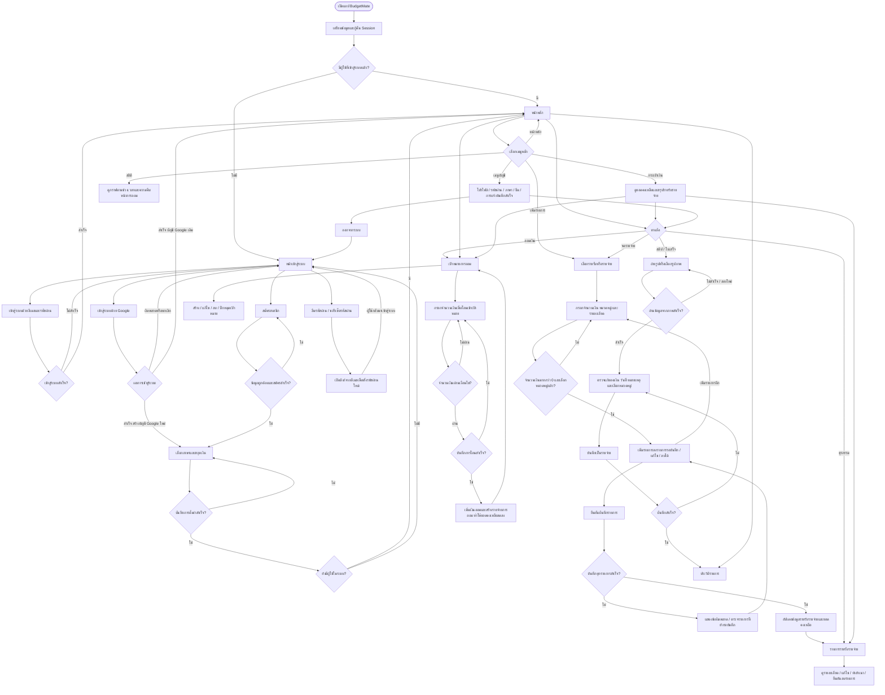

# BudgetMate — App Flowchart

แผนผังภาพรวมการใช้งาน อ้างอิงหน้าจอและเส้นทางใน `flutter_application_1/lib` โดยย่อขั้นตอนภายในเพื่อให้อ่านง่าย

หมายเหตุ:
- ตรวจเทียบโค้ดใน workspace วันที่ 10 ตุลาคม 2026; รูป PNG เป็นแผนผังฉบับย่อ
- Google ใช้ `googleLoginCreatedAccount` เลือกหน้าตั้งค่า ไม่ได้ตรวจว่าบัญชีเดิมตั้งค่าครบหรือไม่
- บันทึกด้วยตนเองสำเร็จไป `IncomeExpenseScreen`; สแกนใบเสร็จสำเร็จไป `HistoryScreen`
- รายการรอบันทึกถูกบันทึกทีละรายการ จึงอาจสำเร็จบางรายการก่อนเกิดข้อผิดพลาด
- เมนูหลักทั้ง 5 แท็บสลับไปมาได้ แผนผังรวมไว้ในจุดเลือกเมนูเพื่อลดเส้นซ้ำ
- ทางลัดมีในหน้าหลัก กระเป๋าเงิน และเมนู ตาม `QuickActions`
- ขั้นตอนเพิ่มรายการ สแกนใบเสร็จ และออมเงินจะตรวจสอบข้อมูลก่อนบันทึก หากไม่ผ่านจะแสดงข้อผิดพลาดให้แก้ไข
- การโอนเข้าเป้าหมายตรวจสอบยอดเงินคงเหลือและจำนวนเงินที่ยังขาดจากเป้าหมาย

ไฟล์อ้างอิงหลัก: `main.dart`, `screens/loading_screen.dart`, `screens/login_screen.dart`, `screens/register_screen.dart`, `screens/language_setup_screen.dart`, `widgets/bottom_nav.dart`, `widgets/quick_actions.dart` และหน้าจอแต่ละฟีเจอร์ใน `screens/`
